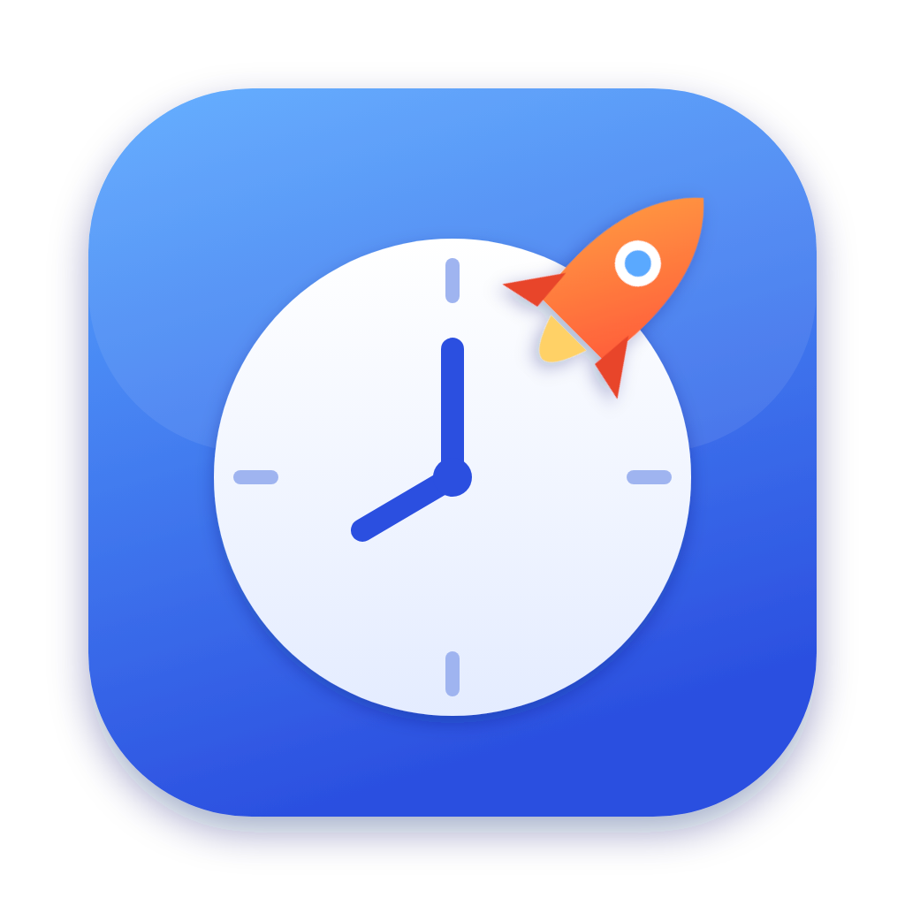
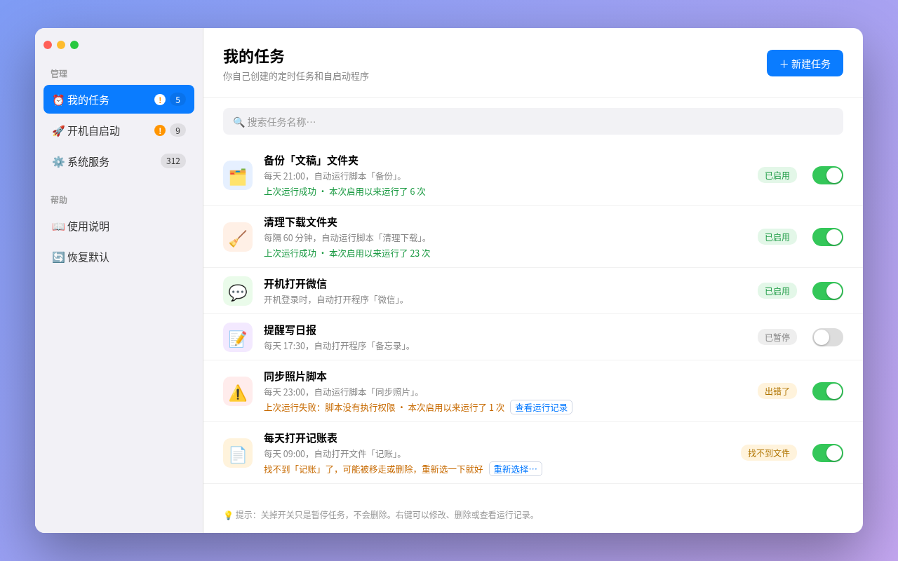
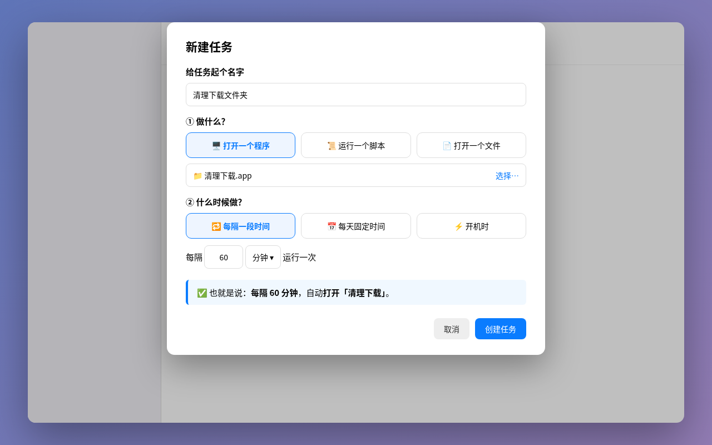
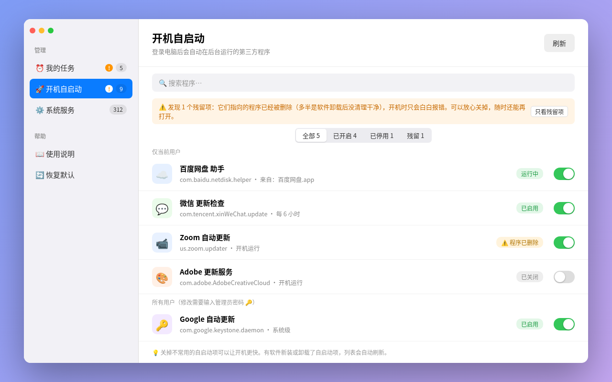
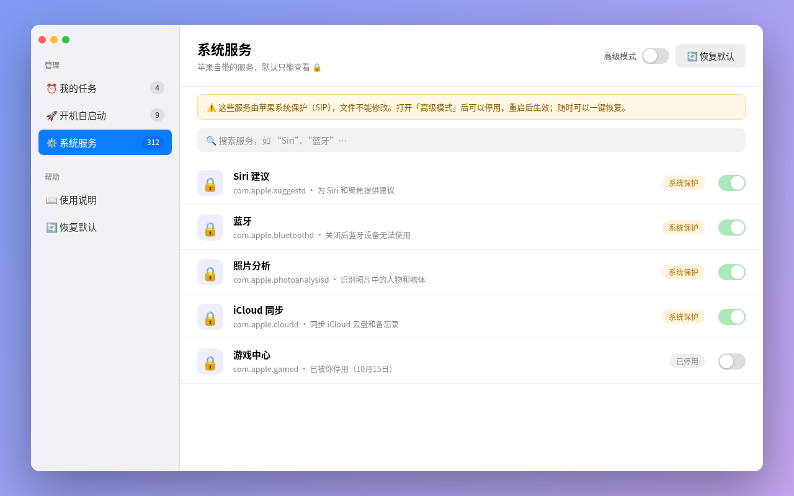

<p align="center"></p>

<h1 align="center">启动台助手 Launchy</h1>

一个免费、界面简单的 macOS 定时任务和开机自启动管理小工具。

这个东西是怎么来的：有一天我想让 Mac 每天晚上自动备份一个文件夹，查了一圈发现苹果的标准做法是 launchd，要手写 XML 格式的 plist 文件，再去终端里敲 `launchctl`。能用的图形化工具倒是有，但都要付费。我就想：要不自己写一个，顺便让家里不太懂电脑的人也能用。

于是有了 Launchy。它不打算做成什么都能调的专业工具，目标就一个：**打开就能看懂，点两下就能用。**

## 长什么样

> 下面是设计稿，实际界面用的是 macOS 原生控件，细节会略有不同。

**我的任务**：你自己建的定时任务，开关一拨就暂停。每个任务下面会显示上次运行的结果；出了问题会直接告诉你原因，并给一个修的按钮。



**新建任务**：只问两个问题，做什么，什么时候做。底下会用一句大白话告诉你它到底会干嘛。



**开机自启动**：各种软件偷偷装的后台程序，看不顺眼的可以关掉。软件卸载后留下的残留项会用橙色标出来，还能按「全部 / 已开启 / 已停用 / 残留」筛选。



**系统服务**：苹果自带的服务，默认只能看。真想动的话得先打开高级模式。



## 能做什么

- **我的任务**
  - 新建、修改、删除定时任务
  - 三种做法：打开一个程序、运行一个脚本、打开一个文件或文件夹
  - 三种时间：每隔 N 分钟（或小时）、每天几点几分、开机登录时
  - 暂停和恢复，暂停后重启电脑也不会偷偷跑起来
  - 右键「立即运行一次」，方便试一下效果
  - 查看运行记录，任务打印的内容和报错都会存在 `~/Library/Logs/Launchy/` 里
  - 每个任务都显示上次运行结果：成功还是失败、启用以来跑了几次。失败时用大白话说原因（比如「脚本没有执行权限」），旁边有「查看运行记录」按钮
  - 要打开的程序、脚本或文件被移走或删掉了，会显示橙色「找不到文件」，点「重新选择…」换一个就行
- **开机自启动**
  - 列出「仅当前用户」「所有用户」「系统级」三类第三方后台服务
  - 一个开关控制启用或关闭。系统级的服务会弹出系统密码框，Launchy 自己不碰你的密码
  - 每一项都显示所属软件的真实图标；找不到软件的，按用途（更新、同步、清理、网络、安全……）配一个彩色小图标
  - 点一下就能看详情：它属于哪个软件、大概是干嘛的（常见的我写了中文说明，其他的靠关键词猜个八九不离十）、什么时候运行、进程号、上次退出码
  - 详情页里可以「立即运行」「停止」「在访达中显示」
  - 顶部可以按「全部 / 已开启 / 已停用 / 残留」筛选，每一项后面带数量
  - 有软件新装或卸载了自启动项，列表会自动刷新，不用手动点「刷新」
  - 自动标出「残留项」：软件已经删了、后台配置还留着的，会显示橙色「⚠️ 程序已删除」，页面顶部也会提醒，详情页会用大白话告诉你怎么处理。只检查第三方服务，不会自动删任何东西
  - 可以编辑：程序、参数、开机运行、定时，也可以直接改原始 plist。保存前会先用 `plutil` 检查格式，再自动备份到 `~/Library/Application Support/Launchy/backups`，改坏了能一键从备份恢复。`/Library` 下的文件保存时会弹一次密码框。保存和恢复都在后台进行，界面不会卡住
- **系统服务**
  - 列出 `/System/Library` 下苹果自带的服务，可以搜索，常见的配了中文名
  - 每个服务都会显示当前状态：运行中、已停止、已停用。几百个服务一次读完，打开页面基本不用等
  - 默认只读，打开「高级模式」后才能停用。点开也能看详情，但只能看不能改
  - 改了马上生效：停用时会顺手把它停掉，启用时会马上加载。需要管理员权限的，从头到尾只弹一次密码框
  - 有些服务被 SIP 护着，没法当场停掉，会标成「重启后生效」，工具栏上会多一个「立即重启」按钮（点了还会再问你一次，不会说重启就重启）
  - 每次修改都有记录，可以一键「恢复默认」

- **其他**
  - 侧边栏会提醒你哪里需要处理：「我的任务」里有任务出错、「开机自启动」里有还开着的残留项时，名字旁边会出现橙色感叹号，鼠标停上去能看到原因
  - 支持 VoiceOver 读屏：每一行读成「名字，状态」，开关和右键里的操作都能在 VoiceOver 的操作菜单里找到

所有任务都存成 `~/Library/LaunchAgents/com.launchy.*.plist`，是标准的 launchd 格式。哪天你不想用 Launchy 了，这些任务照样能跑，也可以直接删掉。

## 下载安装

懒得编译的话，直接下现成的：

1. 打开 [Releases 页面](https://github.com/Zhengmingming1/Launchy/releases/latest)，下载 `Launchy-版本号.dmg`。
2. 双击打开 DMG，把「启动台助手」拖到旁边的「Applications」文件夹里。
3. 第一次打开时，macOS 多半会拦一下，说「无法验证开发者」或者「已损坏」。这是因为我没交苹果每年 99 美元的开发者费用，app 只做了 ad-hoc 签名。处理方法：
   - 打开「系统设置 → 隐私与安全性」，往下翻，看到关于「启动台助手」的提示，点「仍要打开」，再输一次密码。
   - 如果提示「已损坏，无法打开」，在终端执行一次：`xattr -cr /Applications/启动台助手.app`，然后再打开。

只需要折腾这一次，之后就跟普通软件一样了。

### 自动更新

从 0.3.0 开始，Launchy 会自己检查更新（用的是 Mac 上很多软件都在用的 [Sparkle](https://sparkle-project.org)）：

- 默认每天检查一次，有新版本会弹窗问你，你点了「安装」它才会装，不会偷偷升级。
- 想手动检查：菜单栏「启动台助手 → 检查更新…」。
- 不想被打扰：按 `⌘,` 打开设置，关掉「自动检查更新」。
- 每个更新包都用我的密钥签过名，签名对不上 Sparkle 会直接拒绝安装，所以不用担心有人半路换包。

**注意：0.2.0 及更早的版本没有更新功能**，需要你手动下载 0.3.0 装一次，之后就能自动更新了。安装包同时支持 Apple 芯片和 Intel 芯片的 Mac。

## 自己编译

想自己改代码的话，用 Xcode 编译一下就行：

1. 安装 Xcode（App Store 免费下载，需要 macOS 13 或更新的系统）。
2. 下载代码：
   ```bash
   git clone https://github.com/Zhengmingming1/Launchy.git
   ```
3. 用 Xcode 打开 `Launchy` 文件夹里的 `Package.swift`。
4. 顶部的运行目标选「My Mac」，按 `⌘R` 就能跑起来。

想要一个能放进「应用程序」文件夹的正式 `.app`，可以用 XcodeGen 生成工程：

```bash
brew install xcodegen
cd Launchy
xcodegen generate
open Launchy.xcodeproj
```

然后在 Xcode 里选 Product → Archive，导出就行。

或者跟 GitHub 上自动打包用同一个脚本，一条命令直接出 DMG：

```bash
scripts/build-app.sh 0.1.0 --dmg   # 产物在 dist/ 里
```

**第一次打开时**，因为这个 app 没有经过苹果公证，系统可能会说「无法验证开发者」。别慌：打开「系统设置 → 隐私与安全性」，往下翻能看到一条关于 Launchy 的提示，点「仍要打开」就好，只需要点这一次。

## 关于系统服务，请认真看一下

我知道打开高级模式、把一排开关全关掉很爽，但请不要这么干。

- `/System/Library` 下的东西受苹果的系统完整性保护（SIP）保护，Launchy 改不了也删不了这些文件，能做的只是用 `launchctl disable` 告诉系统「下次别启动它」，一般重启后生效。
- 关错了可能会出现蓝牙连不上、iCloud 不同步、聚焦搜不到东西之类的怪事。
- 不认识的服务就别动。真动了也不要紧，「恢复默认」会把通过 Launchy 停用的服务全部打开，重启一下就回来了。
- 实在改乱了，在终端里执行 `launchctl enable system/服务名` 也能手动恢复。

第三方的自启动项（「开机自启动」那页）就放心关吧，最坏的结果也就是那个软件不能自动更新了。

## 常见问题

**任务不执行？**
先看任务下面那行小字，失败了会写原因；再点旁边的「查看运行记录」找详细报错，也可以右键「立即运行一次」试试。显示「找不到文件」的话，点「重新选择…」把挪走的文件重新选上就行。脚本记得要有执行内容，路径里尽量别出现奇怪的字符。

**改完显示「重启后生效」，关掉 Launchy 会丢吗？**
不会。这个标记会一直保留，直到你真的重启了电脑才自动消失。

**电脑睡着的时候，到点的任务还会跑吗？**
「每天几点」的任务会在电脑醒来后补跑一次；「每隔 N 分钟」的任务睡着的时候不跑，醒了接着按间隔跑。这是 launchd 本身的规则，我也没办法。

**脚本说没有权限访问「文稿」「桌面」？**
这是 macOS 的隐私保护。在「系统设置 → 隐私与安全性 → 完全磁盘访问权限」里给 `zsh`（或者你用的那个程序）打开权限就行。

**为什么不上架 App Store？**
App Store 的应用必须在沙盒里运行，而沙盒里没法管理 launchd，这是硬限制。

**卸载 Launchy 之后我的任务还在吗？**
在。它们就是普通的 plist 文件，要清理的话去 `~/Library/LaunchAgents` 删掉 `com.launchy.` 开头的文件即可。

## 现状

目前还在早期版本，每次提交 GitHub Actions 都会在 macOS 上编译一遍，能编过。不过功能我还没在各种系统版本上挨个试过，用着发现 bug 的话，欢迎开 Issue。顺手提个 PR 修了的话，那就更感谢了。

## 许可证

Launchy 使用 [PolyForm Noncommercial License 1.0.0](LICENSE)。

简单说：个人使用、学习、非营利用途都随意，也可以修改和分享；**拿去商用需要先找我授权**。中文说明见 [LICENSE-zh.md](LICENSE-zh.md)，有分歧的地方以英文原文为准。

Copyright (c) 2026 Zhengmingming1
